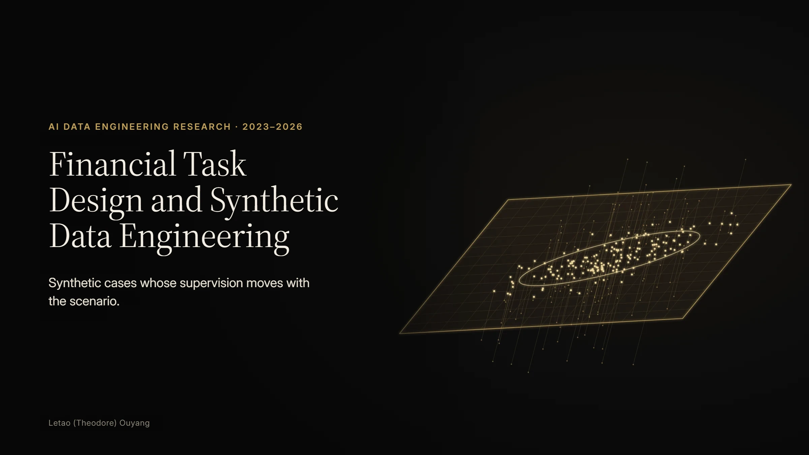
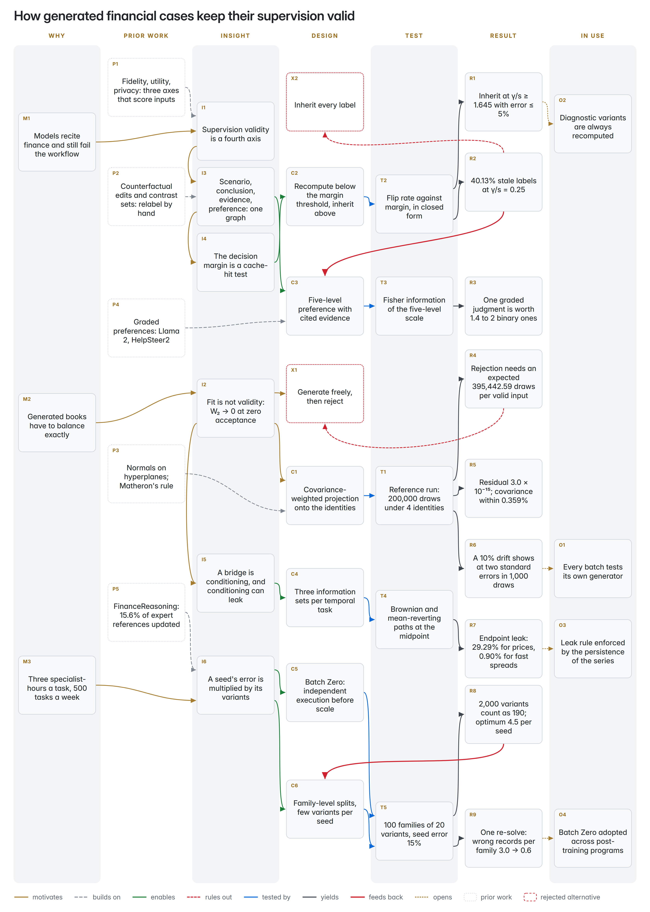

<p align="center"></p>

# Financial Task Design and Synthetic Data Engineering

**Letao (Theodore) Ouyang** · Researcher · Duke University × Leading Foundation Model Developer · September 2023 – September 2026

[Article](manuscript/financial-task-design-and-synthetic-data-engineering.md) · [PDF](paper/paper.pdf) · [Results](reproduce/results.md) · [Derivations](docs/derivations.md) · [Design notes](docs/design-notes.md) · [Research route](docs/research-route.md) · [Literature](docs/literature.md)

**When a synthetic financial case changes one number, is its label still right?**

A generated case is four objects: the scenario, the reference conclusion, the evidence behind it and the expert's
preference between two responses. Change one figure and all four can go stale together. Synthetic data is judged
on fidelity, utility and privacy, and none of the three asks the question; at a margin of a quarter of the
perturbation scale, an inherited label is wrong **40.13%** of the time. I built the rules that decide when each
object has to be recomputed, the generators that keep accounting identities exact as the data scales, and Batch
Zero, the protocol that tests those rules on domain experts before a task family scales. The partner company
adopted Batch Zero across its other post-training programs.

## Three results to start with

| Result | Why it matters | Where |
| --- | --- | --- |
| An inherited label is wrong **40.13%** of the time at a margin-to-noise ratio of 0.25, and 0.13% at 3 | One number, $`\gamma/s`$, separates the variants that cost no expert time from the ones that must be recomputed, with a stated error on every inherited label | [§3](manuscript/financial-task-design-and-synthetic-data-engineering.md) · [D6](docs/derivations.md#d6-stale-label-risk-covenants-and-the-recompute-rule) |
| Four accounting identities hold to **$`3.0 \times 10^{-15}`$** on 200,000 draws, every draw used; rejection would have spent an expected 395,442.59 candidates per valid input | The correction returns the exact conditional distribution, and the distance it moves each draw monitors the generator at no cost | [§2](manuscript/financial-task-design-and-synthetic-data-engineering.md) · [D3](docs/derivations.md#d3-the-covariance-weighted-projection-samples-the-exact-conditional-law) · [D4](docs/derivations.md#d4-the-displacement-is-a-chi-square-monitor) |
| 2,000 variants from 100 task families count as **190** independent observations, and the optimum is 4.5 variants per seed | Past the optimum a variant buys repeated information: the same budget at four or five variants per family has 29% less variance | [§5](manuscript/financial-task-design-and-synthetic-data-engineering.md) · [D9](docs/derivations.md#d9-effective-sample-size-of-clustered-variants) · [D10](docs/derivations.md#d10-seed-leverage-and-the-optimal-number-of-variants) |

All 71 figures in the article are recomputed in [results](reproduce/results.md).

## The problem

In late 2023 frontier models could reproduce corporate finance definitions and still made unpredictable errors in
financial workflows, where a small numerical change or an accounting footnote reverses an investment
recommendation. Synthetic data helps only if the supervision moves with the scenario, and that sets two problems.

1. **The label.** A variant keeps the business narrative and changes a decisive figure, a covenant threshold or a
   macroeconomic input. If the original reference answer stays in place, systematic label errors enter
   post-training, even when every accounting constraint holds.
2. **The structure.** A table that violates Total Assets = Total Liabilities + Equity by a fraction of a
   percentage point is a structural error, and a rate path that exposes a future terminal rate to a forecasting
   task is temporal leakage. A generator can match the distribution and fail both:

```math
W_2(P, Q_\sigma) \le \sigma\sqrt{m} \to 0, \qquad Q_\sigma(M) = 0, \qquad \|P - Q_\sigma\|_{\text{TV}} = 1 .
```

## The idea

I treat the result as a fourth axis of synthetic-data quality, **supervision validity**: the share of generated
cases whose scenario, reference conclusion, evidence and preference are all still correct for the case as
generated. The system that maintains it works like an incremental build.

| Part | Rule | Result |
| --- | --- | --- |
| **The margin is a cache-hit test** | Recompute a variant when $`\gamma/s < z_{1-\alpha}`$; inherit otherwise with $`\Pr(\text{stale}) \le \alpha`$. Exact for covenant tests, which are half-spaces in the accounting levels | Thresholds 1.645 at 5% and 2.326 at 1%; diagnostic variants near the boundary are always recomputed |
| **Condition, do not reject** | $`X = Z + K(b - AZ)`$, $`K = \Sigma A^\top(A\Sigma A^\top)^{-1}`$: one draw, corrected onto the identities, with the exact conditional law | Residual $`3.0 \times 10^{-15}`$, covariance within 0.359% |
| **The correction is a monitor** | $`T = (b - AZ)^\top(A\Sigma A^\top)^{-1}(b - AZ) \sim \chi^2_m(\delta)`$ | A 10% drift upstream shows at two standard errors in a batch of 1,000 draws |
| **A graded preference, priced** | Fisher information of a five-level ordered response about the quality gap | One graded judgment is worth 1.4 to 2 binary ones |
| **Information sets per task** | Construction, permitted predictor and evaluation information are kept apart; the leak from an exposed endpoint is $`1 - (1 + e^{-2\kappa h})^{-1/2}`$ | 29.29% for series close to a unit root, 0.90% for fast-reverting spreads |
| **Batch Zero** | Experts who did not write the specification build the task and re-solve its references before the family scales | One re-solve takes wrong records per family from 3.0 to 0.6 |

## Results

**Stale labels by margin**

| Margin-to-noise $`\gamma/s`$ | 0.25 | 1 | 1.645 | 2 | 2.326 | 3 |
| --- | ---: | ---: | ---: | ---: | ---: | ---: |
| Inherited-label error | 40.13% | 15.87% | 5% | 2.28% | 1% | 0.13% |

**Rejection against conditioning, at a tolerance of 0.05 residual standard deviations**

| Simultaneous constraints | Acceptance rate under rejection | Candidate draws per valid input | Draws used by the projection |
| ---: | ---: | ---: | ---: |
| 1 | 3.9878% | 25.08 | 1 |
| 2 | 0.1590% | 628.84 | 1 |
| 4 | 0.0002529% | 395,442.59 | 1 |

**What a five-level judgment carries**

| Quality gap between two responses | Binary judgment | Five-level judgment | Ratio |
| --- | ---: | ---: | ---: |
| 0 (a tie) | 0.637 | 0.912 | 1.43 |
| 0.5 | 0.581 | 0.902 | 1.55 |
| 1.0 | 0.439 | 0.863 | 1.97 |

**What an exposed endpoint leaks, by persistence of the series**

| $`\kappa h`$ | 0 (Brownian) | 0.25 | 0.5 | 1 | 2 |
| --- | ---: | ---: | ---: | ---: | ---: |
| Apparent RMSE reduction | 29.29% | 21.10% | 14.50% | 6.15% | 0.90% |

**Task families.** With 100 families of 20 variants and within-family correlation 0.5, ignoring the clustering
understates standard errors 3.24 times. With a seed that costs twenty variants, twenty variants per family carry
40% more variance than four or five at the same budget.

## What is new

The projection is the classical sampler for a Gaussian on hyperplanes, and graded preferences and clustered
standard errors have long histories. What I built:

1. **Supervision validity as a fourth axis.** Fidelity, utility and privacy score inputs. I added the axis that
   scores the label, and the dependency graph of four objects that makes it maintainable.
2. **The margin certificate as a cache-hit test.** Counterfactual augmentation and contrast sets restore validity
   by relabeling every edit by hand; templated sets recompute everything. The certificate says which labels may be
   inherited, with an error bound, and it is exact for the covenant family.
3. **A generator that corrects and monitors in one step.** Accounting identities in the place of the hyperplanes,
   exactness stated in the latent coordinates of the copula, and the displacement statistic as a goodness-of-fit
   test that every batch runs on itself.
4. **The price of a graded preference.** The Fisher information of the five-level scale and the cutpoints that
   maximize it.
5. **Leakage in closed form, by persistence.** The Brownian result extended to mean-reverting series, which turns
   an information-set rule into a rule with a severity.
6. **Batch Zero and the economics of the seed.** Seed leverage $`k\varepsilon(1-d)^r`$ and the optimal number of
   variants $`k^* = \sqrt{(c_G/c_v)(1-\rho)/\rho}`$.

[Where this work sits](docs/literature.md) sets each of these against the closest prior work, and the
[bibliography](docs/bibliography.md) lists all 192 sources.

## How the argument was built

<picture>
  <source media="(prefers-color-scheme: dark)" srcset="assets/route-dark.png">
  
</picture>

The route is a network. The label rules, the generator and the expert protocol were worked out against each other,
and three results went back and changed the design.

- **Labels that move with the scenario.** The stale-label rate near the boundary ruled out inheriting every label
  and went back into the preference protocol: near the boundary the workflow collects a fresh five-level judgment.
- **Structure by construction.** The reference run ruled out rejection sampling and showed that the correction
  step is also a measurement of the generator.
- **Expert time at the seed.** The design effect became a prescription: past 4.5 variants per seed the budget goes
  to new families.

The [research route](docs/research-route.md) explains all 40 steps and all 41 links.

## In production

- The team averaged roughly 500 completed financial tasks a week. Each task combined synthetic financial data with
  a reference solution and expert review, and took about three specialist-hours across drafting, three reviews and
  revision.
- Diagnostic cases targeted the decision boundaries where models and practitioners repeatedly err: covenant
  breaches, off-balance-sheet adjustments and valuation differences close to a threshold.
- Batch Zero ran before each task family entered large-scale construction, and the partner company adopted the
  protocol across its other post-training programs.

## If you build synthetic training data

| If you | The article shows | Do this |
| --- | --- | --- |
| Perturb a seed case and keep its answer | The inherited label is wrong at rate $`\Phi(-\gamma/s)`$ | Compute the margin-to-noise ratio of each variant and recompute below the threshold |
| Filter generated tables against business rules | Rejection cost grows geometrically with the number of identities | Condition onto the identities and track the displacement per batch |
| Collect binary preferences from experts | A five-level judgment carries 1.4 to 2 times the information for seconds more | Grade on five levels and record the decisive variable and the evidence |
| Report results over thousands of variants | The family is the unit of evidence | Split and compute intervals by family, and cap the variants per seed near $`k^*`$ |

## Repository

| Path | Contents |
| --- | --- |
| [`manuscript/`](manuscript/financial-task-design-and-synthetic-data-engineering.md) | The article |
| [`paper/paper.pdf`](paper/paper.pdf) | The article as a PDF |
| [`docs/derivations.md`](docs/derivations.md) | Every proof in full, D1 to D11 |
| [`docs/design-notes.md`](docs/design-notes.md) | Each design choice, the alternative it beat, and how a five-level judgment reaches training |
| [`docs/research-route.md`](docs/research-route.md) | The logic of the work as a network, node by node |
| [`docs/literature.md`](docs/literature.md) · [`docs/bibliography.md`](docs/bibliography.md) | Where the work sits, and the 192 sources |
| [`reproduce/`](reproduce/README.md) | Code that recomputes every figure in the article, and the [results](reproduce/results.md) |

## Disclosure

I conducted this project through a Duke University collaboration with a leading foundation model developer. The
partner's name and proprietary system identifiers are withheld under a nondisclosure agreement. The project title,
my role, locations, dates, system architecture and mathematical formulations are cleared for public disclosure.
Production tasks and operating figures are withheld; the numerical results are closed-form values, a reference run
of the constrained generator, and worked examples with their inputs stated.

## Citation

Letao (Theodore) Ouyang, *Financial Task Design and Synthetic Data Engineering* (Duke University, 2026),
<https://www.theodoreoy.com/experience/financial-task-design-and-synthetic-data-engineering/>. See
[CITATION.cff](CITATION.cff).

[theodore.oy2025@gmail.com](mailto:theodore.oy2025@gmail.com) · [10@alumni.duke.edu](mailto:10@alumni.duke.edu)

© Letao (Theodore) Ouyang. All rights reserved.
