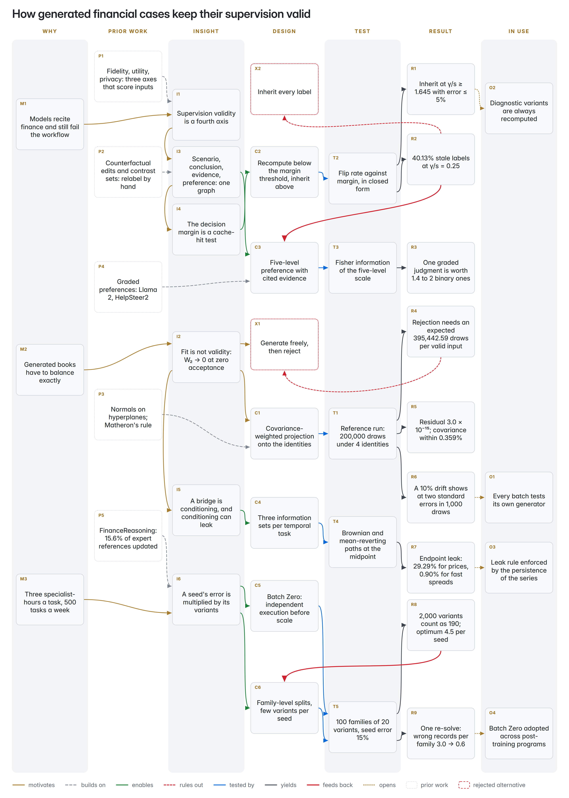

# Research route

How the argument was built: which observation forced which design choice, where a result went back and changed the
design, and what the design became in operation. The work did not run from problem to solution in one line. The
label rules, the generator and the expert protocol were worked out against each other, because a generated case is
only as valid as the weakest of them.

<picture>
  <source media="(prefers-color-scheme: dark)" srcset="../assets/route-dark.png">
  
</picture>

## Reading the figure

Columns are kinds of step, not stages in time. A link can run between any two columns, and four run backwards, from
a result to the design.

| Link | Meaning |
| --- | --- |
| motivates | A need or an insight that made the next step necessary |
| builds on | A published result the step starts from |
| enables | A step that makes another one possible |
| tested by / yields | A design and the test that checks it; a test and what it produced |
| feeds back | A result that changed the design |
| rules out | A finding that excludes an alternative |
| opens | A design or result that became an operating standard |

Solid boxes are my own steps. Dotted boxes are prior work, and red dashed boxes are alternatives I rejected. Design
boxes are numbered C1 to C6 so that they are not confused with the derivations D1 to D11.

## The four threads

### 1. Labels that move with the scenario

M1 → I1 → I3 → I4 → C2 → T2 → R1, R2, with R2 ruling out X2 and feeding back into C3.

Synthetic data is judged on fidelity, utility and privacy (P1), and all three score inputs. A training team has a
different question: is the label attached to this generated case still right? I made that a fourth axis,
supervision validity (I1), and treated a case as four linked objects, the scenario, the reference conclusion, the
evidence and the preference (I3). A change to the scenario marks the others stale, and the decision margin says
which of them may be reused (I4). The rule follows (C2): recompute a variant when its margin-to-noise ratio falls
below $`z_{1-\alpha}`$, and inherit otherwise with error at most $`\alpha`$
([D6](derivations.md#d6-stale-label-risk-covenants-and-the-recompute-rule)).

The closed form (T2) gives both halves of the result. Far from the boundary inheritance is safe: at
$`\gamma/s \ge 1.645`$ the error is at most 5%, and at 3 it is 0.13% (R1). Near the boundary it is not: at
$`\gamma/s = 0.25`$, where diagnostic tasks are built on purpose, 40.13% of inherited labels are wrong (R2). That
result did two things. It ruled out inheriting every label (X2), and it went back into the preference protocol
(R2 → C3): when a perturbation approaches or crosses the boundary, the workflow recomputes the reference, samples
new model trajectories and collects a fresh five-level judgment.

### 2. What an expert judgment carries

I3 → C3 → T3 → R3.

The preference is one of the four objects, so the protocol records it with its reasons (C3): direction, strength
on five levels, the decisive variable, and the evidence and accounting rule behind it. Graded comparison has
precedents (P4); what a grade is worth had not been priced. The Fisher information of an ordered response (T3,
[D7](derivations.md#d7-the-information-in-a-graded-preference)) prices it: one graded judgment carries the
information of 1.4 to 2 binary ones, and the same expression places the cutpoints (R3).

### 3. Structure by construction

M2 → I2 → C1 → T1 → R4, R5, R6, with R4 ruling out X1.

A generator can converge to the valid distribution in Wasserstein distance while no record it produces satisfies
the accounting identities (I2, [D1](derivations.md#d1-distributional-fit-does-not-imply-structural-validity)).
Structure has to be imposed, and there are two ways. Rejection generates freely and discards (X1). Conditioning
draws once and corrects the draw onto the constraint (C1): the covariance-weighted projection, which is the exact
sampler for a Gaussian on hyperplanes (P3) with accounting identities in the place of the hyperplanes
([D3](derivations.md#d3-the-covariance-weighted-projection-samples-the-exact-conditional-law)).

The reference run (T1) settled the choice. Rejection under four identities would have spent an expected 395,442.59
candidate draws per valid input (R4), which rules it out. The projection used every draw, with a maximum residual of
$`3.0 \times 10^{-15}`$ and the conditional covariance matched within 0.359% (R5). The run also showed that the
correction is a measurement (R6): the distance each draw is moved is a chi-square statistic, so every batch tests
the fit of its own generator ([D4](derivations.md#d4-the-displacement-is-a-chi-square-monitor)).

The same conditioning in one dimension is a Brownian bridge, and there it can leak (I2 → I5). A path conditioned on
its endpoint makes a midpoint forecast look 29.29% better than the information at the forecast date allows. The
task specification therefore keeps three information sets apart (C4), and the size of the leak in closed form (T4,
[D8](derivations.md#d8-endpoint-conditioning-and-what-it-leaks)) sets how strictly: 29.29% for series close to a
unit root, 0.90% for fast-reverting spreads (R7).

### 4. Expert time at the seed

M3 → I6 → C5, C6 → T5 → R8, R9, with R8 feeding back into C6.

A task cost about three specialist-hours, so the design question was where expert time removes the most error.
Expert-written references carry a measurable error rate (P5), and a synthetic pipeline multiplies whatever error
its seeds carry (I6). Batch Zero puts the check at the seed (C5): experts who did not write the specification
build the task and re-solve its references before the family scales. One re-solve takes wrong records per family
from 3.0 to 0.6 (R9, [D10](derivations.md#d10-seed-leverage-and-the-optimal-number-of-variants)).

The family is also the unit of evidence (C6). Two thousand variants from one hundred families count as 190
independent observations (R8, [D9](derivations.md#d9-effective-sample-size-of-clustered-variants)). The same
algebra gives the prescription, and it went back into the design (R8 → C6): with a seed that costs twenty variants
the optimum is 4.5 variants per seed, so past that point the budget goes to new families.

## From design to operation

| Standard | Comes from | What it does |
| --- | --- | --- |
| O2 Diagnostic variants are always recomputed | R1 | The threshold separates variants that inherit their labels from variants that get a fresh reference and a fresh five-level judgment |
| O1 Every batch tests its own generator | R6 | The mean displacement is tracked per batch against the number of identities |
| O3 Leak rule by persistence | R7 | The information-set rule is enforced most strictly for prices and long rates |
| O4 Batch Zero across programs | R9 | The partner company adopted the protocol across its other post-training programs |

## Every node

| Node | Column | What it is |
| --- | --- | --- |
| **M1** Models recite finance and still fail the workflow | Why | In late 2023 frontier models reproduced corporate finance definitions and made unpredictable errors where a small numerical change or a footnote reverses a recommendation. |
| **M2** Generated books have to balance exactly | Why | A table that violates Total Assets = Total Liabilities + Equity by a fraction of a percentage point is a structural error, whatever its distributional fit. |
| **M3** Three specialist-hours a task, 500 tasks a week | Why | Expert time is the scarce input: drafting, three reviews and revision on each financial task. |
| **P1** Fidelity, utility, privacy: three axes that score inputs | Prior Work | The standard evaluation of synthetic data and its sample-level refinements (Alaa et al. 2022). None asks whether a generated case's label is still right. |
| **P2** Counterfactual edits and contrast sets: relabel by hand | Prior Work | Kaushik et al. (2020), Gardner et al. (2020): a minimal edit can flip the gold answer, and a person relabels every edited example. |
| **P4** Graded preferences: Llama 2, HelpSteer2 | Prior Work | Strength-graded pairwise comparisons improve reward models. What a grade is worth is left unpriced. |
| **P3** Normals on hyperplanes; Matheron's rule | Prior Work | Cong, Chen and Zhou (2017), Wilson et al. (2021): the exact sampler for a Gaussian conditioned on linear equalities. |
| **P5** FinanceReasoning: 15.6% of expert references updated | Prior Work | Tang et al. (2025): re-examining four public financial reasoning sets changed 15.6% of their questions, between 9.72% and 30.00% per set. |
| **I1** Supervision validity is a fourth axis | Insight | The share of generated cases whose scenario, reference conclusion, evidence and preference are all still correct for the case as generated. |
| **I3** Scenario, conclusion, evidence, preference: one graph | Insight | The four objects form a dependency graph, and a change to the scenario marks everything downstream as stale, as in an incremental build. |
| **I4** The decision margin is a cache-hit test | Insight | The margin-to-noise ratio γ/s says which labels may be inherited without rework, with a stated error (D6). |
| **I2** Fit is not validity: W₂ → 0 at zero acceptance | Insight | A generator can converge in Wasserstein distance while no generated record satisfies the identities and total variation stays at one (D1). |
| **I5** A bridge is conditioning, and conditioning can leak | Insight | A Brownian bridge is the projection of Section 2 in one dimension. Whether its endpoint is leakage depends on the task's information set (D8). |
| **I6** A seed's error is multiplied by its variants | Insight | A wrong reference at the seed is wrong in every variant, and the variants are wrong together (D10). |
| **X2** Inherit every label | Design | Rejected: near a decision boundary the inherited label is wrong 40.13% of the time. |
| **C2** Recompute below the margin threshold, inherit above | Design | Variants with γ/s below z(1−α) are recomputed; the rest inherit their labels with error at most α. |
| **C3** Five-level preference with cited evidence | Design | Each judgment records direction, strength, the decisive variable, the primary evidence and the accounting rule. |
| **X1** Generate freely, then reject | Design | Rejected: the expected number of candidate draws grows geometrically with the number of identities (D2). |
| **C1** Covariance-weighted projection onto the identities | Design | X = Z + K(b − AZ) with K = ΣAᵀ(AΣAᵀ)⁻¹ satisfies every identity exactly and has the exact conditional law (D3). |
| **C4** Three information sets per temporal task | Design | Construction information, the permitted predictor filtration and evaluation information are kept apart in the task specification. |
| **C5** Batch Zero: independent execution before scale | Design | Doctoral-level experts who did not write the specification build the task, re-solve the references and assign five-level preferences before a family enters Batch One. |
| **C6** Family-level splits, few variants per seed | Design | The task family is the unit of coverage and uncertainty; training and evaluation are separated by family, and budgets go to new families past the optimum. |
| **T2** Flip rate against margin, in closed form | Test | Φ(−γ/s) for a linear rule under Gaussian perturbation, exact for covenant tests, checked by direct sampling. |
| **T3** Fisher information of the five-level scale | Test | The information one ordered response carries about the quality gap between two responses (D7). |
| **T1** Reference run: 200,000 draws under 4 identities | Test | Twelve balance-sheet and income fields; assets, liabilities, the balance-sheet identity and receivables at 60 days of revenue. |
| **T4** Brownian and mean-reverting paths at the midpoint | Test | The variance of a midpoint forecast with and without the future endpoint, for a Brownian path and an Ornstein-Uhlenbeck path. |
| **T5** 100 families of 20 variants, seed error 15% | Test | Within-family correlation 0.5, a seed that costs twenty variants, and a re-solve that catches a wrong reference with probability 0.8. |
| **R1** Inherit at γ/s ≥ 1.645 with error ≤ 5% | Result | The thresholds are 1.645 at 5% and 2.326 at 1%; a variant at γ/s = 3 inherits its label with an error of 0.13%. |
| **R2** 40.13% stale labels at γ/s = 0.25 | Result | 15.87% at γ/s = 1 and 2.28% at 2. Two covenants at 1.5 and 2 give at most 8.96%. |
| **R3** One graded judgment is worth 1.4 to 2 binary ones | Result | 0.912 against 0.637 at a tie and 0.863 against 0.439 at a gap of one. The best cutpoints are ±0.38 and ±1.24. |
| **R4** Rejection needs an expected 395,442.59 draws per valid input | Result | Under four constraints at a tolerance of 0.05 standard deviations the acceptance rate is 0.0002529%. |
| **R5** Residual 3.0 × 10⁻¹⁵; covariance within 0.359% | Result | Every draw of the reference run satisfies the identities to rounding error, and the sample covariance matches the conditional covariance. |
| **R6** A 10% drift shows at two standard errors in 1,000 draws | Result | The displacement statistic T is chi-square with mean m + δ; the reference run averages 4.01 against m = 4 (D4). |
| **R7** Endpoint leak: 29.29% for prices, 0.90% for fast spreads | Result | The apparent RMSE reduction is 1 − (1 + e^(−2κh))^(−1/2): 21.10%, 14.50% and 6.15% in between. |
| **R8** 2,000 variants count as 190; optimum 4.5 per seed | Result | Standard errors are understated 3.24 times, and twenty variants per family carry 40% more variance than four or five at the same budget. |
| **R9** One re-solve: wrong records per family 3.0 → 0.6 | Result | And 0.12 after two. One re-solve at the seed does the work of reviewing twenty variants. |
| **O2** Diagnostic variants are always recomputed | In Use | Variants far from the boundary cost no expert time; the ones near it, which the task family exists for, get a fresh reference and a fresh five-level judgment. |
| **O1** Every batch tests its own generator | In Use | The mean displacement is tracked per batch against the number of identities. |
| **O3** Leak rule enforced by the persistence of the series | In Use | Strictest for prices and long rates, which are close to a unit root; light for fast-reverting spreads. |
| **O4** Batch Zero adopted across post-training programs | In Use | The partner company carried the protocol into its other post-training programs. |

## Every link

| # | From | To | Link | Why |
| ---: | --- | --- | --- | --- |
| 1 | M1 | I1 | motivates | If a small change reverses the answer, the label has to move with the scenario |
| 2 | P1 | I1 | builds on | The three standard axes score inputs and leave the label unexamined |
| 3 | I1 | I3 | motivates | Validity is a property of four linked objects, not of the inputs alone |
| 4 | P2 | I3 | builds on | A minimal edit can flip the gold answer |
| 5 | I3 | I4 | motivates | Once a change marks objects stale, something has to say which may be reused |
| 6 | I4 | C2 | enables | The margin-to-noise ratio decides recomputation |
| 7 | I3 | C3 | enables | The preference is one of the four objects, so it is recorded with its reasons |
| 8 | P4 | C3 | builds on | Strength-graded pairwise comparison |
| 9 | C2 | T2 | tested by | What an inherited label costs at each margin |
| 10 | T2 | R1 | yields | The thresholds and the error of an inherited label |
| 11 | T2 | R2 | yields | The stale-label rate near the boundary |
| 12 | R2 | X2 | rules out | Near the boundary two inherited labels in five are wrong |
| 13 | R2 | C3 | feeds back | Near the boundary the workflow samples new model trajectories and collects a fresh five-level judgment |
| 14 | C3 | T3 | tested by | What the extra levels buy |
| 15 | T3 | R3 | yields | The information ratio and the best cutpoints |
| 16 | M2 | I2 | motivates | Exact identities are what distributional metrics cannot see |
| 17 | I2 | X1 | motivates | Filtering is the obvious way to impose structure |
| 18 | I2 | C1 | motivates | Conditioning imposes it by construction |
| 19 | P3 | C1 | builds on | The exact sampler, with accounting identities in the place of the hyperplanes |
| 20 | C1 | T1 | tested by | Exactness of the identities and of the conditional law |
| 21 | T1 | R4 | yields | What rejection would have spent on the same run |
| 22 | T1 | R5 | yields | Constraint residual and covariance error |
| 23 | T1 | R6 | yields | The law of the displacement |
| 24 | R4 | X1 | rules out | Each added identity multiplies the cost of rejection |
| 25 | I2 | I5 | motivates | The same conditioning, applied to a path |
| 26 | I5 | C4 | enables | Leakage becomes a specification error that can be checked |
| 27 | C4 | T4 | tested by | The size of the leak when the endpoint is exposed |
| 28 | T4 | R7 | yields | The leak in closed form, by persistence of the series |
| 29 | M3 | I6 | motivates | Expert time is scarce, so its errors must not be multiplied |
| 30 | P5 | I6 | builds on | Expert-written references carry a measurable error rate |
| 31 | I6 | C5 | enables | The check belongs at the seed |
| 32 | I6 | C6 | enables | The family, not the record, is the unit |
| 33 | C5 | T5 | tested by | Wrong records per family after independent re-solves |
| 34 | C6 | T5 | tested by | Effective sample size and variance at a fixed budget |
| 35 | T5 | R8 | yields | The design effect and the optimal cluster size |
| 36 | T5 | R9 | yields | The leverage of one re-solve |
| 37 | R8 | C6 | feeds back | Past the optimum a variant buys repeated information, so the budget goes to new families |
| 38 | R1 | O2 | opens | The threshold separates variants that inherit from variants that are recomputed |
| 39 | R6 | O1 | opens | The correction step doubles as a goodness-of-fit test |
| 40 | R7 | O3 | opens | The severity of the rule follows the persistence of the series |
| 41 | R9 | O4 | opens | The protocol was adopted beyond the program it was built for |
